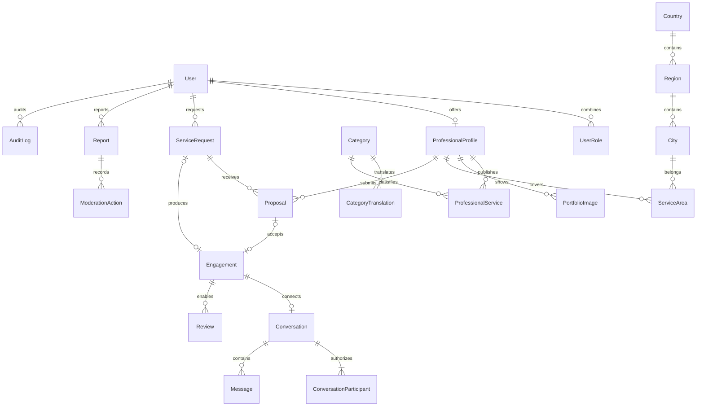

# Arquitectura y modelo

Lup es un monolito modular. `frontend/` contiene React 19, React Router, TanStack Query, React Hook Form, Zod, i18next y Tailwind 4. `backend/` contiene NestJS 11, Prisma 6 y PostgreSQL. Cada área de negocio tiene un módulo Nest. Se mantienen contratos REST, DTOs validados y selecciones explícitas de datos públicos. OpenAPI está disponible solo en desarrollo; no representa una autorización para acceder a recursos.

## Relaciones

El esquema completo y autoritativo está en `backend/prisma/schema.prisma`. UUID, `timestamptz`, importes `Decimal(12,2)`, claves foráneas, índices y migraciones SQL versionadas. Las tablas auxiliares incluyen sesiones, tokens de un solo uso, intentos de login y una cola cifrada de correo. No hay módulo de pagos, comisiones, suscripciones o publicidad.

## Reglas críticas

- Una sola cuenta combina CLIENT y PROFESSIONAL. Ninguna API de usuario acepta roles administrativos. El alta inicial de SUPER_ADMIN requiere un comando offline, una cuenta verificada y una razón auditada.
- Aceptar propuestas bloquea la fila de solicitud con `FOR UPDATE`, comprueba propietario y estados y crea contratación, conversación y notificación en una transacción. El índice único parcial de propuestas aceptadas y la unicidad de `Engagement.requestId` refuerzan la exclusión.
- Las contrataciones directas tienen una clave única por pareja mientras están activas y requieren confirmación del profesional. La clave se libera al terminar o cancelar.
- Una finalización requiere la confirmación de ambos participantes. La reputación solo deriva de contrataciones completadas y una reseña por parte y contratación. Los promedios y distribuciones no se ajustan editorialmente. La reputación pública de un profesional solo agrega reseñas de trabajos donde fue el profesional; las evaluaciones recibidas como cliente no alteran su promedio, distribución, evolución ni lista pública de reseñas.
- La mensajería comprueba participación al leer, enviar y marcar como leída. Polling cada 10–15 segundos; consultas paginadas. Los bloqueos impiden nuevos contactos y envíos en ambos sentidos; el historial previo se conserva.
- El administrador no tiene un endpoint para explorar conversaciones. Solo un mensaje específico denunciado por un participante y con reporte abierto puede consultarse mediante una acción con motivo y auditoría.
- Las fotografías de solicitudes solo se entregan al cliente y al profesional de la contratación. El portafolio es público mediante enlaces firmados de corta duración. El bucket es privado.
- Los datos públicos excluyen correo, teléfono, hashes, tokens y pruebas internas de verificación. Se rechazan datos de contacto evidentes en texto público; esto complementa la moderación y no sustituye revisión humana de direcciones o fotografías.

## Internacionalización

Catálogo inicial real de 8 países y ciudades, editable en PostgreSQL y habilitable desde administración. No hay datos ficticios de profesionales. Las ciudades mantienen zona IANA; los usuarios pueden configurar la suya. Monedas ISO 4217 validadas por `Intl`, teléfonos E.164 y formatos regionales. ES/EN completos; el catálogo permite traducciones `pt`, pero el idioma portugués de la interfaz sigue pendiente.

Las coordenadas de ciudades son opcionales y el seed no inventa valores. El MVP filtra por cobertura de país, región y ciudad. No se presentan distancias sin coordenadas. La búsqueda por radio utiliza distancias calculadas sobre centros de ciudades con coordenadas disponibles y lo explica al usuario; se omiten ciudades sin coordenadas. Los profesionales pueden añadir y eliminar zonas aproximadas de cobertura.

## Límites y operación

30 servicios por perfil; las búsquedas entregan una especialidad y hasta 220 caracteres de biografía, con detalles y portafolio cargados solo al abrir el perfil. 12 fotografías por portafolio (configurable), 5 por solicitud, 5 MB por archivo, imágenes estáticas JPEG/PNG/WebP, máximo 24 millones de píxeles decodificados. Se reorienta, reduce a 1600 px, convierte a WebP y elimina EXIF. 5 solicitudes diarias por cliente, 20 reportes diarios y límites HTTP por IP. Una propuesta por profesional y solicitud. Sin archivos adjuntos en mensajes.

La API usa una instancia por ahora: el contador HTTP por IP es de memoria. Las sesiones, intentos por dirección de correo, contratos y colas son persistentes. Antes de escalar horizontalmente se necesita un almacén compartido para rate limiting, métricas operativas y coordinación de mantenimiento. La cola de correo (SMTP o Resend por HTTPS) usa bloqueo `SKIP LOCKED`, cinco reintentos y caducidad de 24 horas; su contenido se cifra con AES-256-GCM. Solo se registra el ID del trabajo y el número de intento, nunca su correo o enlace secreto.
